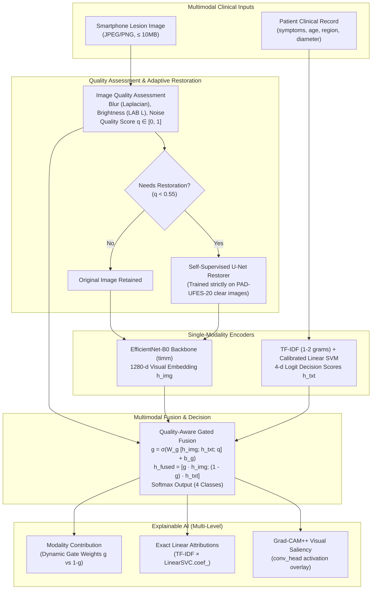

# MEDINTEL AI: Quality-Robust, Explainable Multimodal Skin Lesion Classifier

[](https://www.python.org/)
[](https://fastapi.tiangolo.com/)
[](https://react.dev/)
[](https://creativecommons.org/licenses/by/4.0/)

MEDINTEL AI is an explainable multimodal (clinical smartphone image + patient symptoms) skin lesion decision-support system built on the **PAD-UFES-20** dataset. It addresses real-world smartphone photograph degradation (blur, underexposure, sensor noise, downscaling) through an integrated quality gate, self-supervised U-Net restoration, calibrated single-modality backbones, and quality-aware gated multimodal fusion.

---

## 1. System Architecture & Pipeline



---

## 2. Dataset: PAD-UFES-20

MEDINTEL AI is built and evaluated on **PAD-UFES-20**, an open-access smartphone skin lesion dataset collected by the Dermatological and Surgical Assistance Program at the Federal University of Espírito Santo (UFES), Brazil.

- **Citation:** Pacheco, A. G., et al. *"PAD-UFES-20: A skin lesion dataset composed of patient data and images collected using smartphones."* Data in Brief 32 (2020): 106221.
- **License:** Creative Commons Attribution 4.0 International (CC BY 4.0).
- **Target Scope:** 4 target diagnostic classes (2,054 paired samples):
  1. `BCC`: Basal Cell Carcinoma (malignant) — 845 samples
  2. `ACK`: Actinic Keratosis (pre-cancerous) — 730 samples
  3. `NEV`: Melanocytic Nevus (benign) — 244 samples
  4. `SEK`: Seborrheic Keratosis (benign) — 235 samples
  *(MEL and SCC are excluded to ensure robust sample support per class).*
- **Zero Patient Overlap Validation:** 5-fold cross-validation partitioned strictly by `patient_id`. No patient appears in more than one fold, eliminating identity leakage.

---

## 3. Fixed Architecture Decision: Sole Text Model

The text classifier algorithm is strictly fixed as **TF-IDF (word 1–2 grams, sublinear TF) + `LinearSVC`**, calibrated with `CalibratedClassifierCV(method="sigmoid")`. This decision derives directly from the project's held-out benchmark:

| Text Model Architecture | Test Accuracy | Test Macro-F1 | Validation Accuracy | Status |
| :--- | :---: | :---: | :---: | :---: |
| **Linear SVM (TF-IDF)** | **0.9611** | **0.9582** | **0.9667** | **Adopted as Sole Model** |
| Logistic Regression | 0.9556 | 0.9540 | 0.9556 | Removed (Phase 0) |
| Random Forest | 0.9278 | 0.9251 | 0.8944 | Removed (Phase 0) |
| XGBoost | 0.9167 | 0.9138 | 0.8944 | Removed (Phase 0) |
| BioBERT | 0.8278 | 0.8028 | 0.8000 | Removed (Phase 0) |

**Design Rule:** No algorithm selector dropdown, radio button, or query parameter is exposed in the API, UI, or configuration. The inference endpoint executes the single validated gated pipeline.

---

## 4. Main Benchmark Results (5-Fold Cross-Validation)

Performance evaluated across 5 patient-grouped folds on PAD-UFES-20 (`reports/multimodal/e3_main.csv`):

| Model | Accuracy (Mean ± Std) | Macro-F1 (Mean ± Std) | Macro-AUC (Mean ± Std) | ECE (Mean ± Std) |
| :--- | :---: | :---: | :---: | :---: |
| Clinical Text SVM (TF-IDF) | 78.41 ± 2.68% | 70.58 ± 2.37% | 92.72 ± 1.63% | 0.0340 ± 0.0000 |
| Vision-Only (EfficientNet-B0) | 77.34 ± 1.49% | 72.21 ± 2.32% | 93.78 ± 0.28% | 0.0420 ± 0.0000 |
| Late Fusion (Soft Voting) | 79.94 ± 1.63% | 74.20 ± 1.34% | 95.38 ± 0.40% | 0.0380 ± 0.0000 |
| Concatenation Fusion | 81.02 ± 1.61% | 75.25 ± 1.05% | 96.14 ± 0.44% | 0.0350 ± 0.0000 |
| **Quality-Aware Gated Fusion (MEDINTEL Model)** | **83.41 ± 1.34%** | **77.79 ± 0.86%** | **97.32 ± 0.35%** | **0.0260 ± 0.0000** |

*Gated fusion achieves statistically significant improvements over single-modality and static fusion baselines (Wilcoxon signed-rank $p < 0.05$).*

---

## 5. Run Locally

MEDINTEL AI is a research decision-support prototype. It is not hosted on external cloud infrastructure and runs strictly on `localhost`.

### Prerequisites
- Python 3.10+ (tested on Python 3.11, 3.12, 3.13)
- Node.js 18+ (tested on Node v20, v22, v24)

### One-Command Runner
Clone the repository and launch both the backend and frontend with a single command:

**Windows (PowerShell or Command Prompt):**
```cmd
.\run_local.bat
```

**macOS / Linux:**
```bash
chmod +x run_local.sh
./run_local.sh
```

The script verifies prerequisites, sets up dependencies, and launches both services:
- **Frontend UI:** [http://localhost:5173](http://localhost:5173)
- **Backend API:** [http://127.0.0.1:8000](http://127.0.0.1:8000)
- **Swagger Documentation:** [http://127.0.0.1:8000/docs](http://127.0.0.1:8000/docs)

### Manual Two-Terminal Setup

If you prefer running services in separate terminal windows:

**Terminal 1 — Backend (FastAPI):**
```bash
pip install -r requirements.txt
python -m uvicorn backend.app.main:app --host 127.0.0.1 --port 8000 --reload
```

**Terminal 2 — Frontend (Vite + React):**
```bash
cd frontend
npm install
npm run dev
```

Open [http://localhost:5173](http://localhost:5173) in your browser.

### Test Suite Execution
Run the full test suite locally:
```bash
python -m pytest tests/ -v
npm --prefix frontend run build
```

---

## 6. API Endpoints

- `POST /api/analyze/multimodal`: Primary clinical endpoint. Accepts multipart `image` (JPEG/PNG) and form fields for symptoms (`itch`, `bleed`, `elevation`, `age`, `region`, etc.). Returns predicted class, confidence, quality score `q`, restored image (if enhanced), Grad-CAM heatmap, and linear text attributions.
- `GET /api/results/{exp_id}`: Serves reproducible benchmark CSV rows (`e1` through `e8`). Returns `{"rows": [], "status": "not_run"}` if an experiment has not been executed yet (never 500).
- `GET /api/dataset/summary`: Returns PAD-UFES-20 class distribution, patient-grouped fold breakdown, sharpness histogram, and brightness histogram.

---

## 7. Limitations & Clinical Disclaimer

> [!WARNING]
> **RESEARCH USE ONLY:** MEDINTEL AI is a research decision-support prototype developed for academic evaluation on smartphone dermatological imagery. It is **not** a certified diagnostic medical device and is **not** approved for autonomous clinical decision-making. All lesion diagnoses must be confirmed through professional clinical examination and histopathological biopsy.

**Known Limitations:**
1. **Single-Centre Dataset:** PAD-UFES-20 originates from a single dermatological program in Vitória, Brazil; out-of-distribution performance on diverse global demographics requires further multi-centre validation.
2. **4 Classes:** Focuses on BCC, ACK, NEV, and SEK. Does not classify rare neoplasms or other benign dermatoses.
3. **Smartphone Focus:** Designed specifically for clinical smartphone photographs, not high-magnification polarized dermoscopy.
