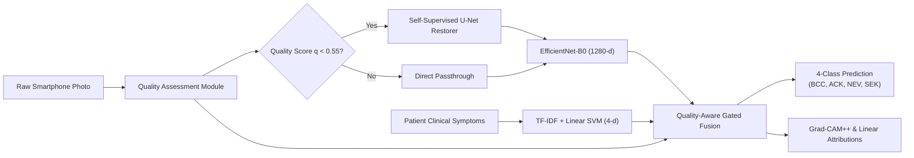

# System Architecture & Technical Specification

MEDINTEL AI is an explainable multimodal decision-support classifier designed to analyze low-quality smartphone skin lesion images in tandem with structured patient clinical records.

---

## 1. End-to-End Multimodal Pipeline

---

## 2. Tensor Shapes & Mathematical Formulations

### 2.1 Visual Stream (EfficientNet-B0)
- **Input:** $X_{\text{img}} \in \mathbb{R}^{B \times 3 \times 224 \times 224}$ (RGB normalized with ImageNet statistics $\mu = [0.485, 0.456, 0.406], \sigma = [0.229, 0.224, 0.225]$).
- **Backbone:** EfficientNet-B0 initialized from ImageNet weights via `timm`.
- **Feature Extraction:** Global average pooled visual embedding $h_{\text{img}} = \text{AdaptiveAvgPool2d}(\text{conv\_head}(X)) \in \mathbb{R}^{B \times 1280}$.

### 2.2 Clinical Text Stream (TF-IDF + Linear SVM)
- **Input:** Patient narrative synthesized deterministically from clinical symptoms (itch, grew, hurt, changed, bleed, elevation, age, region, diameter).
- **Features:** Word 1–2 grams with sublinear TF scaling ($1 + \log(\text{tf})$), maximum 2,500 features.
- **Model:** `LinearSVC(C=1.0)` calibrated using `CalibratedClassifierCV(method="sigmoid")`.
- **Output:** Calibrated decision logits / log-odds vector $h_{\text{txt}} \in \mathbb{R}^{B \times 4}$.

### 2.3 Image Quality Assessment
- **Laplacian Variance:** $s_{\text{blur}} = \text{Var}(\nabla^2 I_{\text{gray}})$, normalized by $\hat{s}_{\text{blur}} = \min(1, \frac{s_{\text{blur}}}{300})$.
- **Lightness:** $s_{\text{bright}} = 1 - \frac{|L^*_{\text{mean}} - 128|}{128}$, where $L^*$ is CIELAB channel.
- **Noise:** $s_{\text{noise}} = \max(0, 1 - \frac{\hat{\sigma}}{25})$.
- **Combined Quality Score:**
  $$q = 0.5 \cdot \hat{s}_{\text{blur}} + 0.3 \cdot s_{\text{bright}} + 0.2 \cdot s_{\text{noise}} \in [0, 1]$$

### 2.4 Quality-Aware Gated Fusion
The deployed fusion module combines visual features, clinical logits, and scalar image quality score $q$:
1. Modality projection:
   $$z_{\text{img}} = \text{LayerNorm}(\text{ReLU}(W_{\text{img}} h_{\text{img}} + b_{\text{img}})) \in \mathbb{R}^{B \times d}$$
   $$z_{\text{txt}} = \text{LayerNorm}(\text{ReLU}(W_{\text{txt}} h_{\text{txt}} + b_{\text{txt}})) \in \mathbb{R}^{B \times d}$$
2. Dynamic Quality Gate:
   $$g = \sigma(W_g [z_{\text{img}}; z_{\text{txt}}; q] + b_g) \in (0, 1)$$
3. Gated Fusion Representation:
   $$h_{\text{fused}} = [g \cdot z_{\text{img}}; (1 - g) \cdot z_{\text{txt}}] \in \mathbb{R}^{B \times 2d}$$
4. Final Classification Logits:
   $$y = W_c h_{\text{fused}} + b_c \in \mathbb{R}^{B \times 4}$$

When image quality $q$ degrades, $g \to 0$, automatically attenuating corrupted visual features and elevating reliable clinical symptoms.

---

## 3. Explainability Modules

1. **Grad-CAM++ (Vision):** Targets the last convolutional layer (`conv_head`). Uses higher-order positive partial derivatives to compute visual attribution masks without requiring retraining.
2. **Exact Linear Attributions (Clinical):** Directly computes $\phi_i = \text{tfidf}_i \cdot w_{c, i}$ for each active n-gram. Attributions are mathematically exact with 0 variance.
3. **Gate Attribution (Fusion):** Returns dynamic weight $g \in [0, 1]$ directly indicating model reliance on visual vs clinical evidence.
